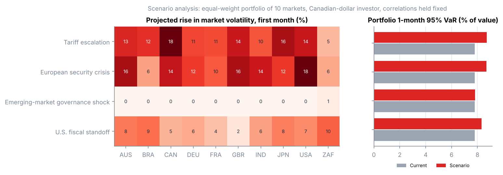
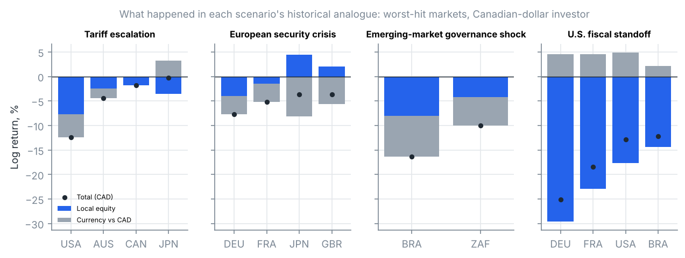
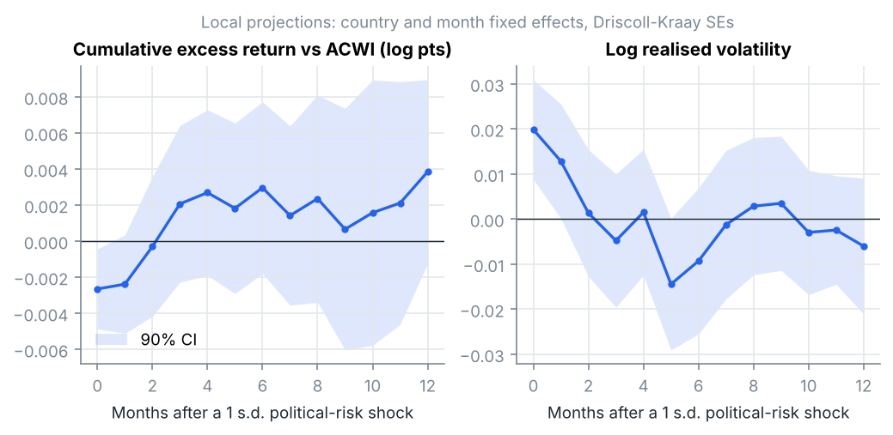
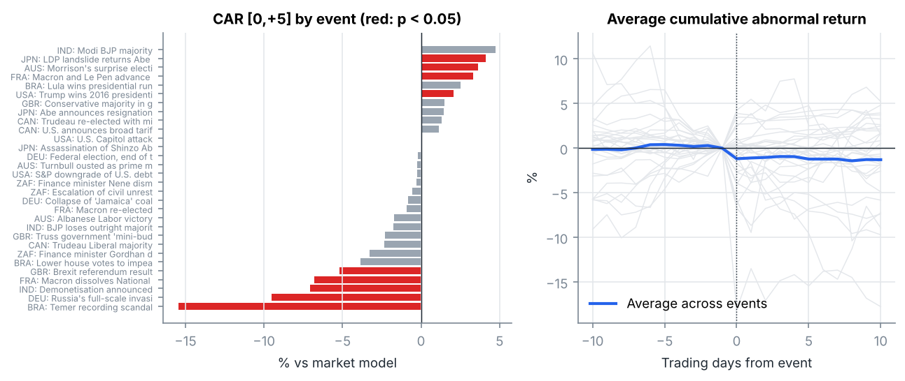

# Political Risk and the Global Equity Mix

How should a multi-asset fund account for political risk across its country exposures? This project builds a monthly political risk index for 10 equity markets (2008–2026) and tests what it means for returns, volatility, event risk and country allocation. It then turns the results into forward-looking geopolitical scenarios for a Canadian-dollar fund. Results are refreshed monthly by GitHub Actions; the latest briefing is in [`results/briefing.md`](results/briefing.md), and the full write-up is in [`report/Political_Risk_Report.pdf`](report/Political_Risk_Report.pdf).

## Main findings

Data: 10 markets, May 2008 to July 2026, 2,124 country-month observations, 30 political events.

1. **Political risk is a volatility story, not a return story.** A one-standard-deviation political-risk surprise raises a country's realised volatility by about **2% in the same month** (p = 0.003), relative to other markets that month. Including moves shared across markets, the panel VAR shows volatility rising about **6% on impact**, then decaying to under 1% within four months (still statistically above normal for most of the year).
2. **No lasting return penalty.** The same shock comes with a −0.26 pp excess return versus ACWI in the month (p = 0.05), which reverses within a quarter. Markets reprice political risk quickly rather than drifting lower.
3. **What kind of event matters more than whether there is one.** Unscheduled **governance shocks**, such as finance-minister dismissals and leadership scandals, cost **−4.8% over three days** on average (n = 8, p = 0.02). **Scheduled elections** show no significant effect (+0.8%, n = 14, p = 0.46), because markets price and hedge them in advance.
4. **A simple underweighting rule adds little.** Halving exposure to the three markets with the fastest-rising political risk improved return/volatility only from 0.28 to 0.30 (information ratio 0.16), before costs.

5. **Scenarios: what to do if…** The four scenarios below are each calibrated to a historical episode and applied to an equal-weight portfolio of the 10 markets held by a Canadian-dollar investor.
   - **Tariff escalation** (like February to April 2025): volatility rises most in Canada (+18%) and Japan (+16%). The portfolio's one-month 95% value at risk (VaR) rises from 7.8% to 8.7%, so holding risk constant means cutting exposure by about 10%. In 2025, U.S. stocks lost a Canadian investor 11.7%: 7.4% from the market and 4.6% from a weaker U.S. dollar.
   - **European security crisis** (like the 2022 invasion of Ukraine): volatility rises across all markets, and VaR increases by a similar amount. German stocks lost a Canadian investor 7.4%, about half of it from the euro.
   - **U.S. fiscal standoff** (like the 2011 debt-ceiling downgrade): VaR rises by about 7%. Even though the crisis started in the U.S., the U.S. dollar rose by about 5% as a safe haven and cushioned Canadian investors' losses.
   - **Emerging-market governance shock** (Brazil 2017, South Africa 2015): the news-based indices **barely registered** these episodes, yet Brazil fell 15% for a Canadian investor within a month. This is a blind spot, and governance risk needs separate monitoring.

**Implications:**
- Political risk belongs in the **risk budget** (position sizing, risk limits, hedging around unscheduled instability) rather than in return forecasts.
- Whether the U.S. dollar acts as a safe haven depends on the type of crisis. It cushioned Canadian investors in 2011, but in the 2025 tariff episode it added to their losses.






## Data

| Input | Source | Frequency |
|---|---|---|
| Economic Policy Uncertainty (EPU) by country | Baker, Bloom and Davis (2016), [policyuncertainty.com](https://www.policyuncertainty.com) | Monthly |
| Country Geopolitical Risk (GPR) | Caldara and Iacoviello (2022), [matteoiacoviello.com/gpr.htm](https://www.matteoiacoviello.com/gpr.htm) | Monthly |
| Country equity returns, in USD | iShares country ETFs (IVV, EWG, EWJ, EWU, EWQ, EWC, EWA, INDA, EWZ, EZA) via `yfinance` | Daily |
| Global benchmark | iShares MSCI ACWI | Daily |
| Exchange rates (CAD, EUR, JPY, GBP, AUD, INR, BRL, ZAR per USD) | Yahoo Finance via `yfinance` | Daily |

Countries: United States, Germany, Japan, United Kingdom, France, Canada, Australia, India, Brazil and South Africa. USD returns put the markets on a common basis and reflect what a foreign investor earns, currency included. The sample starts in April 2008 (ACWI launch); India starts in 2012 (INDA launch). South Africa has no EPU series, so its index uses GPR alone.

## Method

**Political Risk Index (PRI).** Log EPU and log GPR are standardised within each country and combined using first-principal-component weights. With two standardised inputs this is an equal-weighted average. Two versions are kept:
- `pri`: full-sample standardisation, used in the econometrics.
- `pri_rt`: expanding-window standardisation, which uses only data available at the time, so the backtest has no look-ahead.

The **political-risk shock** is the standardised AR(1) innovation in each country's PRI: the part of this month's political risk that was not predictable from last month.

**Panel local projections** (Jordà, 2005). For horizons of 0–12 months, the cumulative excess return over ACWI and log realised volatility are regressed on the shock, controlling for two lags of each. Country and month fixed effects isolate each country's own political risk from global shocks. Driscoll-Kraay standard errors allow for cross-country and serial correlation.

**Fixed-effects panel VAR** of [shock, excess return, log volatility]. Lags are built within each country, lag length is chosen by BIC, and the model is identified with a Cholesky ordering (political risk first). Bands come from a 500-draw country-cluster bootstrap.

**Event study.** The normal return for each event comes from a market model on ACWI fitted over trading days [−250, −30]. Cumulative abnormal returns are reported for [−1,+1], [0,+5] and [0,+10]. Tests are run per event and across events with the Boehmer-Musumeci-Poulsen standardised test, by event type (election, policy shock, governance, geopolitical, unrest).

**Portfolio applications:**
- *Regimes:* next-month outcomes by within-month PRI tercile.
- *Tilt backtest:* equal-weight country portfolio vs. halving the three fastest-rising PRI markets, using signals known at the start of each month.
- *Stress tests:* returns during Brexit, the 2016 U.S. election, the Russian invasion of Ukraine, the UK mini-budget and the 2025 U.S.–Canada tariff shock.

**Scenarios.** Each scenario is calibrated to a historical analogue: a country's shock is its largest political-risk surprise in the analogue months, so the scenario reflects how risk actually spread across countries. The panel VAR turns each shock into projected volatility, using the response per standard deviation of the structural shock. With the last year's correlations held fixed, this gives the portfolio's one-month 95% VaR and the exposure cut needed to keep VaR unchanged. The analogue's daily window then shows what happened to a Canadian-dollar investor, splitting each market's return into local equity and currency against the Canadian dollar.

## Outputs (`results/`)

| File | Content |
|---|---|
| `briefing.md` | Investment briefing: findings, total-fund implications, current country read, stress tests |
| `fig1_political_risk_index.png` | PRI over time |
| `fig2_local_projections.png` | Return and volatility responses to a political-risk shock |
| `fig3_panel_var_irf.png` | Panel VAR impulse responses |
| `fig4_event_study.png` | Abnormal returns by event and on average |
| `fig5_regimes.png` | Outcomes by political-risk tercile |
| `fig6_backtest.png` | Tilt vs. equal weight: growth and drawdowns |
| `fig7_stress_tests.png` | Market returns in political-stress windows |
| `fig8_scenarios.png` | Projected volatility by scenario and market, and portfolio VaR |
| `fig9_scenario_analogues.png` | Analogue returns for a Canadian investor, split into equity and currency |
| `*.csv` | All underlying tables |

## How to run

```bash
pip install -r requirements.txt
python run_analysis.py              # downloads data (cached in data/), writes results/
python run_analysis.py --refresh    # re-download prices
python run_analysis.py --synthetic  # offline demo on simulated data
pytest                              # tests
```

The **Analysis** workflow runs the tests on every push and pull request. Each month, and on demand, it reruns the analysis on the latest data and commits the updated `results/`.

## Tests

The tests run on simulated data with a known effect built in: a political-risk shock lowers next-month returns by 2%, and events carry a −2% abnormal return. They check that:
- the models recover the built-in effects, and the event study finds nothing when no effect is present;
- the real-time index and portfolio weights never use future data;
- portfolio weights always sum to one;
- scenario shocks are never negative, a zero shock leaves VaR unchanged, and the equity and currency parts add up to the Canadian-dollar return.

## Limitations

- Ten markets and 18 years limit statistical power, and some event types have only 2–3 events.
- The panel VAR depends on its ordering assumption; the local projections do not.
- EPU and GPR are text-based measures and pick up media attention as well as underlying risk.
- Excess returns are in USD and include currency effects.
- The backtest excludes transaction costs; turnover is reported so their effect can be judged.
- Scenario projections assume each market responds only to its own political risk and that correlations stay fixed. Correlations usually rise in a crisis, so these projections understate the risk.

## Project structure

```
political_risk/
  config.py        countries, tickers, data sources, events, stress windows
  data.py          downloads with caching, plus a synthetic data generator
  index.py         Political Risk Index and shocks
  econometrics.py  monthly panel, local projections, panel VAR
  events.py        market-model event study with BMP tests
  allocation.py    regimes, tilt backtest, stress tests
  scenarios.py     forward-looking scenarios: volatility, portfolio VaR, currency split
  report.py        charts and briefing
run_analysis.py    end-to-end pipeline
results/           latest charts, tables and briefing
report/            written report (LaTeX source and PDF)
tests/             tests on synthetic data
```

## Background

This project extends my earlier [Political Risk and Financial Markets](https://github.com/divvygupta/The-Impact-of-Political-Risk-on-Financial-Markets-A-Panel-VAR-and-Event-Study-Analysis) study. That study used annual governance indicators for 2005–2020 and found no significant long-run effect on volatility or FDI, plus event reactions of 3–5% that were not significant at 5%. This project tests whether that null result came from the data rather than the economics:
- monthly data instead of annual, with about 11 times as many observations;
- inputs that capture political-risk news rather than slow-moving governance scores;
- an event model that removes global market moves;
- a direct link to portfolio decisions.

**Tools:** Python, pandas, NumPy, SciPy, scikit-learn, linearmodels, Matplotlib, yfinance, pytest, GitHub Actions
